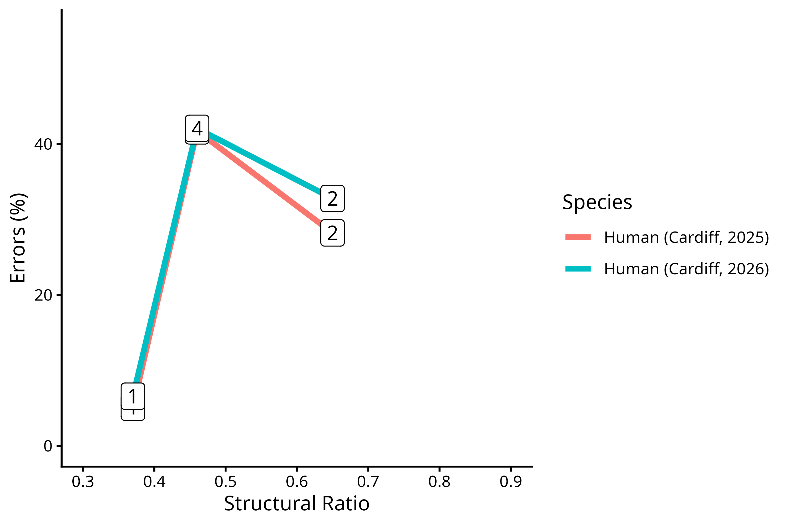

Replication is pretty important for science, and so, I tried my [SHJ tasks demo](/blog/2026/reflecting-shj) again this year. Same university, younger cohort. I'm quite chuffed by the results. We got a pretty clean effect, and the consistency between 2025 and 2026 is quite remarkable.

 

(Refinement is also important, so I tweaked my plots a little bit to plot the tasks as a function of their structural complexity)

If you are interested, the source code for this demo is available [here](https://gitlab.pavlovia.org/vicnavar/shj) (Pavlovia login required). All `jsPsych` references are hosted on Pavlovia's servers, but if you want to serve it locally, just change those references to your local jsPsych installation (7+).